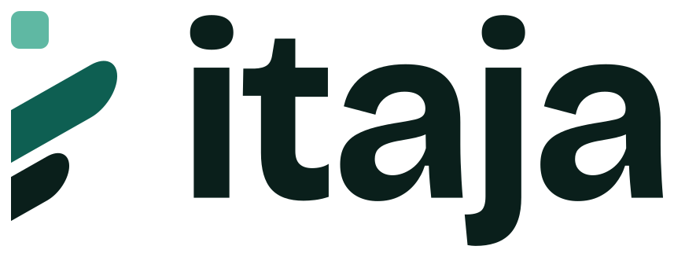

<div align="center">
  <picture>
    <source media="(prefers-color-scheme: dark)" srcset="assets/itaja-logo-dark.svg">
    
  </picture>

  <h3>Get paid in Africa without a local company.</h3>

  <p>Itaja is the merchant of record for software sold in Africa — mobile money, cards and wallets,<br>subscriptions, prepaid credits and licence keys, taxes and payouts.<br>You ship the product; Itaja collects, bills and pays you.</p>

  <p><a href="https://getitaja.com">Website</a> · <a href="https://docs.getitaja.com">Documentation</a> · <a href="https://api.getitaja.com/api/references">API reference</a></p>

  <p><a href="https://status.getitaja.com"></a></p>

  <p><sub>Private beta, opening soon — join the waiting list on <a href="https://getitaja.com">getitaja.com</a>.</sub></p>
</div>

---

## Build with Itaja

**[Agent skills](https://github.com/itaja/skills)** — let a coding agent integrate Itaja into your app, securely, against the live API. It reads your repository, picks the right package for your language and checks every step in sandbox before going live.

```sh
npx skills add itaja/skills
```

**[Server SDKs](https://github.com/itaja/itaja-sdks)** — one package per language.

| Stack | Package |
|---|---|
| Node.js, Bun, Deno, Workers | [`@itaja/node`](https://www.npmjs.com/package/@itaja/node) |
| Python — Django, FastAPI, Flask | [`itaja`](https://pypi.org/project/itaja/) |
| Laravel | [`itaja/itaja-laravel`](https://packagist.org/packages/itaja/itaja-laravel) |

---

## Talk to us

Questions and partnerships: [hello@getitaja.com](mailto:hello@getitaja.com)<br>
Security issues: [report privately](https://github.com/itaja/.github/blob/main/SECURITY.md) — never in a public issue.
